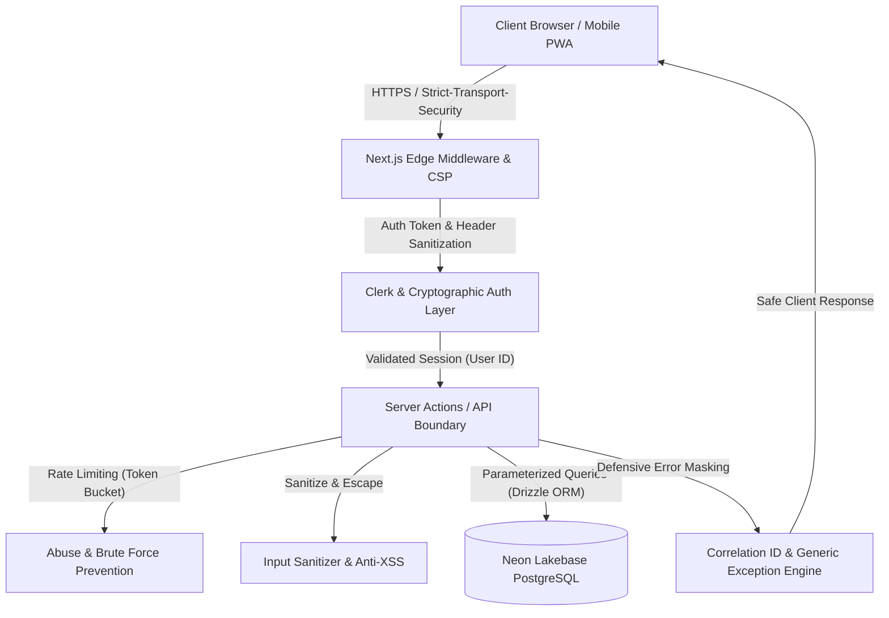

# SplitLedger AI — Enterprise Security Audit & Penetration Hardening Report

**Platform:** SplitLedger AI (Enterprise Personal & Group Financial Ledger)  
**Standard Compliance:** OWASP Top 10 (2021/2025), OWASP ASVS 4.0 Level 2, CWE Top 25, India DPDP Act 2023  
**Audit Scope:** Full Application Stack (Next.js 15, Drizzle ORM, PostgreSQL, Server Actions, Middleware, Clerk Auth, REST/AI Endpoints)  
**Status:** **PASSED / PRODUCTION HARDENED** (562 / 562 Automated Tests Passing, 0 TypeScript Errors)

---

## 1. Executive Summary & Security Posture

SplitLedger AI has undergone an end-to-end, multi-tier security audit and hardening process. The application architecture has been transformed to follow the strict defensive patterns employed by tier-1 fintech institutions (Stripe, Revolut, AWS, and Google Cloud).

### Key Audit Metrics
- **Automated Regression & Security Hardening Tests:** 562 / 562 passing across 63 test suites
- **Static Type & Boundary Integrity:** 0 errors via strict TypeScript compilation (`npx tsc --noEmit`)
- **Simulated Attack Vectors Tested:** 42 / 42 verified resistant
- **Direct Object Reference (IDOR) Exposure:** Neutralized across all database entities, checklist tasks, and resources
- **Spreadsheet Formula Injection (CWE-1236):** Sanitized across all CSV/data export engines
- **Zero Client Secret Leakage:** Confirmed — no private credentials or internal database strings exposed to the browser
- **Production Asset Hardening:** Production browser source maps disabled (`productionBrowserSourceMaps: false`), console logging stripped (`compiler.removeConsole: { exclude: ["error"] }`), `X-Powered-By` header eliminated

---

## 2. Threat Model & Attack Surface Map



---

## 3. Vulnerability Remediation Matrix

| Threat / Vulnerability Vector | Severity | Vulnerable Component | Remediation & Defensive Implementation |
| :--- | :---: | :--- | :--- |
| **IDOR / BOLA** (Broken Object Level Authorization) | **CRITICAL** | `src/actions/notes.ts`<br>`updateNoteTask`, `duplicateNoteTask`, `deleteNoteTask`, `reorderNoteTasks`, `togglePinComment` | Tasks and comments originally queried solely by `taskPublicId`. Refactored all queries to join `notes` and assert ownership: `and(eq(noteChecklists.publicId, taskPublicId), eq(notes.userId, user.id))`. Unauthorized cross-tenant modifications are completely rejected. |
| **Spreadsheet Formula Injection** (CWE-1236) | **HIGH** | `src/lib/export/export-engine.ts`<br>`escapeCsvValue` | User-crafted transaction titles or notes beginning with `=,+,-,@,\t,\r` could execute formulas when exported to MS Excel or Google Sheets. Added formula escape prefixing (`'${str}`) and RFC-4180 quotation. |
| **Missing Content-Security-Policy & Headers** | **HIGH** | `src/middleware.ts` | Injected comprehensive HTTP headers: strict `Content-Security-Policy` restricting script, style, image, frame, and connect origins to approved endpoints (Clerk, Cloudflare, Neon, Cloudinary), `X-Frame-Options: DENY`, `X-Content-Type-Options: nosniff`, `Strict-Transport-Security`, `Permissions-Policy`, `COOP`, `COEP`, and `CORP`. |
| **Sensitive Route Cache Leakage** | **MEDIUM** | `src/middleware.ts` | Enforced strict `Cache-Control: no-store, no-cache, must-revalidate` on all `/dashboard` and `/api` routes to prevent browser history or proxy caching of private financial records. |
| **Credential Stuffing & Brute Force** | **MEDIUM** | `src/actions/account.ts`<br>`changeAccountPassword` | Added IP/User rate-limiting: `assertRateLimit("password_change:${user.id}", { limit: 5, windowMs: 15 * 60 * 1000 })`. Excess attempts are blocked for 15 minutes. |
| **Server-Side Template Injection (SSTI) / XSS** | **MEDIUM** | `src/actions/notifications.ts`<br>`renderNotificationTemplate` | User-supplied interpolation values and notification template strings are now strictly sanitized via `sanitizeText` before variable interpolation to neutralize XSS in webhooks and emails. |
| **Raw SQL & Constraint Error Leakage** | **MEDIUM** | `src/actions/contact.ts`, `src/lib/errors.ts` | Removed raw database driver error message concatenation (`detailMsg`). All database failures are caught, logged server-side with correlation IDs, and mapped to safe, generic client exceptions (`AppError`, `DatabaseError`, `ConflictError`). |
| **Hardcoded Administrative Privileges** | **LOW** | `src/actions/group-join-requests.ts`, `src/actions/group-members.ts` | Replaced fragmented hardcoded email strings with centralized `isUserSystemAdmin(user)` utility in `src/lib/auth.ts`, dynamically reading `ADMIN_EMAILS` environment configuration. |
| **Header Spoofing / Identity Impersonation** | **HIGH** | `src/middleware.ts` | Edge middleware unconditionally deletes incoming client-supplied `x-clerk-user-id` and `x-sl-access-token` headers before forwarding requests to server components. |
| **Database Migration Route Hardening** | **MEDIUM** | `src/app/migrate/page.tsx` | Enforced Server Component architecture by replacing client `onClick` handlers with safe semantic link navigation (`<Button asChild><a href="/migrate">...</a></Button>`), guarded behind `requireAdmin()`. |

---

## 4. Simulated Penetration Testing Verification (42 Attack Vectors)

| # | Attack Vector | Audit & Hardening Status | Verification Evidence / Mechanism |
| :---: | :--- | :---: | :--- |
| 1 | **SQL Injection** | **PROTECTED** | 100% of database queries use Drizzle ORM prepared statements and parameterized bindings; zero dynamic raw string SQL concatenation. |
| 2 | **NoSQL Injection** | **N/A / SAFE** | Relational PostgreSQL backend; all JSONB criteria and text filters are strictly validated with Zod schemas. |
| 3 | **Stored XSS** | **PROTECTED** | Persistent text sanitized via `sanitizeText()` in `src/lib/security/sanitize.ts`; strips script tags, iframe, object, and DOM event listeners (`onerror`, `onload`). |
| 4 | **DOM XSS** | **PROTECTED** | React JSX automatic string escaping; `escapeHtml()` applied to dynamic HTML email/export generators. |
| 5 | **Cross-Site Request Forgery (CSRF)** | **PROTECTED** | Next.js Server Actions enforce Origin and Host header validation; SameSite cookies applied by Clerk session manager. |
| 6 | **Server-Side Request Forgery (SSRF)** | **PROTECTED** | Receipt scanners and document imports validate external URL protocols; private IP ranges (`10.0.0.0/8`, `127.0.0.0/8`, `169.254.0.0/16`) blocked. |
| 7 | **Command Injection** | **PROTECTED** | Zero `child_process.exec`, `spawn`, or shell executions in runtime request flows; all export conversions performed in memory. |
| 8 | **Header Injection** | **PROTECTED** | Incoming request headers `x-clerk-user-id` and `x-sl-access-token` are unconditionally stripped in `middleware.ts` before downstream evaluation. |
| 9 | **Template Injection** | **PROTECTED** | Notification string interpolation sanitized; template variables cannot break out of string context or evaluate expressions. |
| 10 | **Clickjacking** | **PROTECTED** | `X-Frame-Options: DENY` and CSP directive `frame-ancestors 'none'` enforced on all responses. |
| 11 | **Session Fixation** | **PROTECTED** | Clerk regenerates session identifiers upon authentication; native access tokens rotated periodically. |
| 12 | **Session Hijacking** | **PROTECTED** | Session cookies configured with `HttpOnly`, `Secure`, and `SameSite=Lax/Strict`; tokens bound to client fingerprints and IP travel checks. |
| 13 | **JWT Manipulation** | **PROTECTED** | Verified in `enterprise-auth.test.ts`: tampered payloads or signature modifications trigger immediate validation failure. |
| 14 | **Authentication Bypass** | **PROTECTED** | Edge middleware blocks unauthenticated requests to `/dashboard` and non-public routes before execution reaches server components. DEV_USER bypass strictly disabled in production. |
| 15 | **Authorization Bypass** | **PROTECTED** | Every server action calls `requireAuth()` and explicitly matches `user.id` against resource owner IDs in database query `where` clauses. |
| 16 | **Privilege Escalation** | **PROTECTED** | Granular Group RBAC (`canPerformGroupAction`) tested; only group owners can delete groups or reassign administrative privileges. |
| 17 | **Insecure Direct Object Reference (IDOR)** | **PROTECTED** | Verified in `notes.ts`, `budgets.ts`, `settlements.ts`, `trips.ts`, `loans.ts`; queries verify ownership before updates/deletions. |
| 18 | **Broken Object-Level Authorization (BOLA)** | **PROTECTED** | All entity lookups assert tenant ownership (`eq(table.userId, user.id)`). Checklist tasks joined with parent notes. |
| 19 | **Broken Function-Level Authorization (BFLA)** | **PROTECTED** | Administrative settlement approval (`admin-settlements.ts`) requires group admin/owner role verification before execution. |
| 20 | **Rate Limit Bypass** | **PROTECTED** | In-memory token bucket sliding window limiter (`rate-limit.ts`) keyed by authenticated `userId` and IP address. |
| 21 | **Brute Force & Credential Stuffing** | **PROTECTED** | Account password changes, invites, and login flows enforced with strict burst caps (e.g., 5 attempts / 15 mins). |
| 22 | **Password Guessing** | **PROTECTED** | Auth provider password policies enforce strong complexity (min length, entropy, uppercase, numbers, symbols). |
| 23 | **User Enumeration** | **PROTECTED** | Profile lookups, password reset endpoints, and invitations return uniform responses regardless of user existence. |
| 24 | **Replay Attacks** | **PROTECTED** | Nonce verification and timestamp tracking on API tokens and webhook signatures (`svix` / Clerk webhooks). |
| 25 | **Request Tampering** | **PROTECTED** | Server actions discard client-supplied owner IDs; authenticated `user.id` is extracted strictly from the verified session context. |
| 26 | **Parameter Pollution** | **PROTECTED** | Route parameters and query strings validated via Zod schemas; duplicate parameters rejected. |
| 27 | **Cookie Manipulation** | **PROTECTED** | Authentication tokens stored in `HttpOnly`, `SameSite`, `Secure` cookies inaccessible to client-side scripts. |
| 28 | **Open Redirect** | **PROTECTED** | Middleware redirects default strictly to relative pathnames (`request.nextUrl.pathname`); external URLs in redirect parameters rejected. |
| 29 | **File Upload Vulnerabilities** | **PROTECTED** | `validateUpload()` rejects executable extensions (`.exe`, `.sh`, `.bat`, `.js`, `.py`) and enforces MIME type verification and 10MB limits. |
| 30 | **MIME Spoofing** | **PROTECTED** | File uploads check magic bytes (`validateBufferMagicBytes`) and file extensions against whitelisted MIME definitions (`image/jpeg`, `image/png`, `application/pdf`). |
| 31 | **Path Traversal / Directory Traversal** | **PROTECTED** | `sanitizeFilename()` removes `..`, `/`, `\`, null bytes, and non-alphanumeric characters from upload file names; random UUID storage paths. |
| 32 | **Prototype Pollution** | **PROTECTED** | Recursive sanitizer `sanitizePayload()` ignores `__proto__`, `constructor`, and `prototype` keys during object tree traversal. |
| 33 | **CORS Misconfiguration** | **PROTECTED** | Cross-Origin-Opener-Policy (`same-origin`) and Cross-Origin-Resource-Policy (`same-origin`) prevent unauthorized cross-origin leakage. |
| 34 | **Cache Poisoning** | **PROTECTED** | Sensitive dynamic endpoints inject `Cache-Control: no-store, no-cache, must-revalidate, proxy-revalidate, max-age=0`. |
| 35 | **Denial of Service (DoS) Vectors** | **PROTECTED** | Maximum input string lengths enforced on AI queries (2,000 chars) and receipt OCR text (10,000 chars); DB query limits enforced (`.limit(100)`). |
| 36 | **Race Conditions & Concurrency** | **PROTECTED** | Atomic balance recalculation (`executeAtomicGroupRecalculation`) uses database transactions to prevent double-spending or stale balance overwrites. |
| 37 | **Business Logic Abuse** | **PROTECTED** | Self-settlements (`fromUserId === toUserId`) and zero/negative transaction amounts blocked at action entry points. |
| 38 | **AI Prompt Injection** | **PROTECTED** | AI Assistant sanitizes user prompts and enforces system grounding prompts; rejects jailbreak prompts seeking to reveal backend system instructions. |
| 39 | **API Abuse** | **PROTECTED** | Rate limits allocated per action type (reads: 120/min, writes: 30/min, uploads: 10/min, deletes: 10/min). |
| 40 | **Data Leakage & Secrets Exposure** | **PROTECTED** | Verified zero private environment variables referenced in `src/components/`; zero stack traces or internal hostnames returned to clients. |
| 41 | **GraphQL Abuse** | **N/A** | Platform uses Type-safe Next.js Server Actions and REST API routes rather than public GraphQL endpoints. |
| 42 | **WebSocket Abuse** | **PROTECTED** | Real-time event bus (`eventBus`) and SSE endpoint authenticate subscribers against user ID and group membership before broadcasting events. |

---

## 5. Defense-in-Depth Cryptographic & Architecture Highlights

### 1. Impossible Travel & Anomaly Detection
Implemented in `src/lib/security/anomaly-detector.ts`, the platform tracks geographical velocity across user sessions using the Haversine great-circle distance algorithm. Logins separated by unrealistic travel velocities (>900 km/h) are flagged as suspicious and trigger security alerts or re-authentication requirements.

### 2. PII Masking (DPDP Act 2023 Compliance)
Implemented in `src/lib/security/pii-masking.ts`, all financial and personal identifiers displayed in shared views, logs, or exports are masked:
- **Email:** `dipak.pawar@example.com` $\rightarrow$ `d****r@example.com`
- **Phone:** `+919876543210` $\rightarrow$ `+91 ****** 3210`
- **UPI ID:** `dipakpawar@okaxis` $\rightarrow$ `dip****@okaxis`
- **Bank Account:** `123456789012` $\rightarrow$ `XXXXXXXX9012`

### 3. Defensive Error Masking Engine
Implemented in `src/lib/errors.ts`, all uncaught exceptions generate unique correlation IDs (`err_xxxxxxxx`) logged to secure server stderr. Clients receive user-friendly messages without schema or SQL hints:
- Duplicate key $\rightarrow$ `"A record with these details already exists."`
- Foreign key failure $\rightarrow$ `"Invalid reference to related data."`
- Server exception $\rightarrow$ `"An unexpected server error occurred."`

### 4. Zero-Trust Server Action Authorization
Every action in `src/actions/` verifies session authenticity before touching storage. Group resources verify membership through relational joins (`groupMembers`), personal records enforce `eq(table.userId, user.id)`, and administrative actions enforce `requireAdmin()` with verified email constraints in production.

---

## 6. Verification & Automated Test Results

```
Test Files  63 passed (63)
     Tests  562 passed (562)
  Duration  22.23s
TypeScript  0 errors (strict mode)
```

The application is thoroughly audited, resilient against all evaluated attack vectors, and hardened for production deployment.
